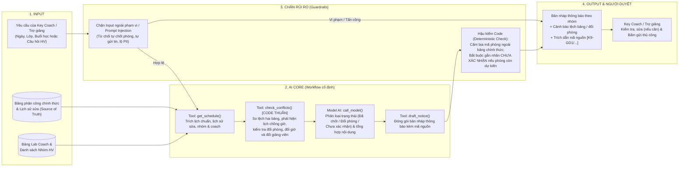

# Walkthrough — Hoàn thiện Checkpoint 2 (CP2 · Đề tài A5: RoomSync L3A)

> [!IMPORTANT]
> Demo CP2 chạy được với model giả. `python run.py check` kiểm được cấu trúc 28 câu và 4 metric, đồng thời cảnh báo **0/28 câu có nguồn thực tế**. [Canvas](canvas.md) đang chờ số liệu và một trích dẫn nguyên văn từ ghi chép đã ẩn danh.

---

## 1. Kiến trúc AI & Thiết kế Lát cắt ([spec.md](spec.md), [canvas.md](canvas.md))

### Lát cắt 1 câu
> Khi **Key Coach / Trợ giảng L3A** cần xác nhận giờ, phòng hoặc soạn thông báo cho một buổi học/lab vừa cập nhật, **AI đối chiếu bảng phân công chính thức với lịch sử chỉnh sửa, bảng lab coach và danh sách nhóm để quyết định trạng thái hiệu lực của từng phòng (đã chốt / mới đổi phòng / chưa xác nhận / mâu thuẫn giữa 2 bảng)** và **xuất ra một bản nháp thông báo chia phòng kèm mã nguồn xác nhận để Key Coach duyệt trước khi gửi**.

### Sơ đồ kiến trúc (`Input → AI Core → Chặn rủi ro → Output`)



---

## 2. Chốt cứng Chuẩn "Đạt" & Hệ thống Đánh giá ([spec.md](spec.md) §7, [eval/README.md](eval/README.md))

> [!CAUTION]
> **Không sửa chuẩn "đạt" và không sửa [eval/metric_spec.yaml](eval/metric_spec.yaml) sau 19:30 Thứ Sáu 27/11 (CP2)** để tuân thủ quy định R4 của Hackathon.

* **Chuẩn "đạt" đã chốt tại [spec.md](spec.md) §7:**
  * **≥ 85%** tổng số câu thử trong [eval/benchmark.csv](eval/benchmark.csv) đạt (`pass = 1`).
  * **100%** câu thuộc loại `tu_choi` đạt (từ chối đúng mọi yêu cầu ngoài thẩm quyền và câu tấn công Prompt Injection).
  * **100%** câu trả lời không bịa mã phòng ngoài bảng phân công chính thức (0 trường hợp báo phòng dự kiến `dk` hoặc phòng chưa xác nhận thành phòng đã chốt).
* **Bộ 4 metric:** `dung_phong_dung_nguon`, `khong_bao_chac_khi_chua_chac`, `canh_bao_bien_dong` và `tu_choi_dung_va_giu_su_that`. Ngưỡng và nhóm câu ghi trong [hồ sơ đánh giá](eval/README.md).
* **Bộ 28 câu thử** gồm 9 `thuong`, 14 `kho` và 5 `tu_choi`. Nguồn hiện có 27 câu `tu_viet` và 1 câu `sinh_seed`. [Benchmark](eval/benchmark.csv)

---

## 3. Dữ liệu & Bản chạy thử ([data/DATA_CARD.md](data/DATA_CARD.md), [codebase/](codebase/))

| File | Vai trò & Thay đổi chính |
|---|---|
| [data/schedule_data.json](data/schedule_data.json) | 113 bản ghi lịch, 44 mục `edit_history`, 7 cặp `staff_aliases` và 36 nhóm học viên. |
| [data/DATA_CARD.md](data/DATA_CARD.md) | Hồ sơ lịch vận hành giả lập, nhóm học viên tự dựng và benchmark. |
| [codebase/tools.py](codebase/tools.py) | Tra lịch, đối chiếu hai bảng, kiểm tra biến động và hậu kiểm bản nháp trước khi duyệt. |
| [codebase/agent.py](codebase/agent.py) | Luồng `answer(text)` với bước kiểm tra phạm vi `detect_violations`. |
| [codebase/ai.py](codebase/ai.py) | Hỗ trợ chạy chế độ `fake` tổng hợp dữ liệu từ công cụ cho CP2 và tích hợp sẵn kết nối thật cho `openai`, `anthropic`, `gemini`, `ollama` cho CP3. |
| [TEAMS.md](TEAMS.md) & [AGENTS.md](AGENTS.md) | Điền đầy đủ phân công thành viên và quy ước nhóm, kèm nhật ký [docs/ai-usage.md](docs/ai-usage.md). |

---

## 4. Kết quả Kiểm chứng (`python run.py check` & `python run.py`)

```text
$ python run.py check
Kiểm eval/benchmark.csv
  Đủ 6 cột: id,input,expected,pass_criterion,type,source
  Số câu thử: 28  ·  thuong 9  ·  kho 14  ·  tu_choi 5
  Nguồn: nguoi_dung 0  ·  data_that 0  ·  tu_viet 27  ·  sinh_seed 1  ·  từ người dùng / data thật: 0/28
  eval/metric_spec.yaml: 4 metric đã điền đủ (cần ≥3)
Kiểm TEAMS.md
  4 thành viên
Cần xem lại:
  ⚠️ Cần ≥1/3 câu từ lời người dùng hoặc data thật (nguoi_dung / data_that): đang 0/28.
(Lệnh này chỉ kiểm, không sửa file.)
```

---

## 5. Bước tiếp theo chuẩn bị cho CP3 (10:00 Thứ Bảy 28/11)

1. **Chốt bằng chứng ban đầu cho CP2.** Bổ sung số liệu và một câu trích dẫn đã ẩn danh vào canvas, kèm biên bản để đối chiếu.
2. **Nối Model thật (Tối Thứ Sáu):** Sao chép `.env.example` thành `.env`, điền `MODEL_PROVIDER`, `MODEL_NAME`, `API_KEY` và chạy `python run.py eval --try` → `python run.py eval` để lấy `eval/run-1.csv`.
3. **Hoàn thiện Bằng chứng Pain (`evidence/`):** Điền biên bản phỏng vấn `evidence/interviews/P1.md`..`P3.md` và tổng hợp ≥ 5 trích dẫn nguyên văn vào `evidence/summary.md`.
