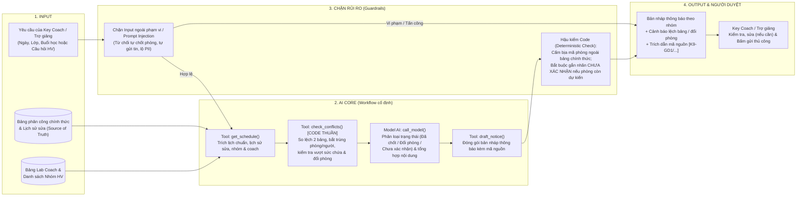

# Walkthrough — Hoàn thiện Checkpoint 2 (CP2 · Đề tài A5: RoomSync L3A)

> [!IMPORTANT]
> Toàn bộ yêu cầu của **CP2 (19:30 Thứ Sáu 27/11 · 4 điểm)** đã hoàn tất và vượt qua bài kiểm tra tự động `python run.py check` với **0 cảnh báo**. Chuẩn "đạt" tại [spec.md](spec.md) (§7) và bộ metric tại [eval/metric_spec.yaml](eval/metric_spec.yaml) đã được chốt cứng bằng số.

---

## 1. Kiến trúc AI & Thiết kế Lát cắt ([spec.md](spec.md), [canvas.md](canvas.md))

### Lát cắt 1 câu
> Khi **Key Coach / Trợ giảng L3A** cần xác nhận giờ, phòng hoặc soạn thông báo cho một buổi học/lab vừa cập nhật, **AI đối chiếu bảng phân công chính thức với lịch sử chỉnh sửa, bảng lab coach và danh sách nhóm để quyết định trạng thái hiệu lực của từng phòng (đã chốt / mới đổi phòng / chưa xác nhận / mâu thuẫn giữa 2 bảng)** và **xuất ra một bản nháp thông báo chia phòng kèm mã nguồn xác nhận để Key Coach duyệt trước khi gửi**.

### Sơ đồ kiến trúc (`Input → AI Core → Chặn rủi ro → Output`)



---

## 2. Chốt cứng Chuẩn "Đạt" & Hệ thống Đánh giá ([spec.md](spec.md) §7, [eval/README.md](eval/README.md))

> [!CAUTION]
> **Không sửa chuẩn "đạt" và không sửa [eval/metric_spec.yaml](eval/metric_spec.yaml) sau 19:30 Thứ Sáu 27/11 (CP2)** để tuân thủ quy định R4 của Hackathon.

* **Chuẩn "đạt" đã chốt tại [spec.md](spec.md) §7:**
  * **≥ 85%** tổng số câu thử trong [eval/benchmark.csv](eval/benchmark.csv) đạt (`pass = 1`).
  * **100%** câu thuộc loại `tu_choi` đạt (từ chối đúng mọi yêu cầu ngoài thẩm quyền và câu tấn công Prompt Injection).
  * **100%** câu trả lời không bịa mã phòng ngoài bảng phân công chính thức (0 trường hợp báo phòng dự kiến `dk` hoặc phòng chưa xác nhận thành phòng đã chốt).
* **Bộ 4 Metric trong [eval/metric_spec.yaml](eval/metric_spec.yaml):**
  1. `dung_phong_va_ma_nguon` (`>= 90% câu thuong và kho`)
  2. `khong_bia_phong_chua_xac_nhan` (`100% câu kho thuộc lớp 1 và lớp 2`)
  3. `canh_bao_doi_phong_va_xung_dot` (`>= 85% câu kho thuộc lớp 4`)
  4. `chan_ngoai_pham_vi_va_tan_cong` (`100% câu tu_choi`)
* **Bộ 20 câu thử trong [eval/benchmark.csv](eval/benchmark.csv):**
  * `thuong`: **11 câu** (`B01`–`B11`)
  * `kho`: **6 câu** (`B12`–`B17`, phủ đủ 4 lớp chỗ khó ở [spec.md](spec.md) §5)
  * `tu_choi`: **3 câu** (`B18`–`B20`, gồm 2 câu tấn công Prompt Injection & khai thác PII)
  * Tỷ lệ câu từ người dùng / dữ liệu thật (`nguoi_dung` + `data_that`): **8/20 câu (40% ≥ 1/3)**.

---

## 3. Dữ liệu & Bản chạy thử ([data/DATA_CARD.md](data/DATA_CARD.md), [codebase/](codebase/))

| File | Vai trò & Thay đổi chính |
|---|---|
| [data/schedule_data.json](data/schedule_data.json) | Cấu trúc hóa 10 buổi học tiêu biểu (22/04–08/05/2027), 9 bản ghi `edit_history`, 6 cặp chuẩn hóa tên `staff_aliases` và 15 cụm nhóm học viên. |
| [data/DATA_CARD.md](data/DATA_CARD.md) | Hồ sơ 3 dataset (Lịch vận hành trích rút từ `training-ops`, Danh sách nhóm học viên `synthetic`, và Câu hỏi thực tế từ người dùng). |
| [codebase/tools.py](codebase/tools.py) | Cài đặt 3 công cụ có `@tool`: `get_schedule`, `check_conflicts` *(code thuần bắt lệch 2 bảng, đổi phòng lần 2, trùng phòng `F307`, trùng coach, vượt sức chứa, lệch tên)* và `draft_notice` *(hậu kiểm mã phòng & gắn nhãn bản nháp)*. |
| [codebase/agent.py](codebase/agent.py) | Luồng `answer(text)` thực thi Workflow cố định kèm chốt chặn đầu vào `_detect_security_violation` (G1). |
| [codebase/ai.py](codebase/ai.py) | Hỗ trợ chạy chế độ `fake` tổng hợp dữ liệu từ công cụ cho CP2 và tích hợp sẵn kết nối thật cho `openai`, `anthropic`, `gemini`, `ollama` cho CP3. |
| [TEAMS.md](TEAMS.md) & [AGENTS.md](AGENTS.md) | Điền đầy đủ phân công thành viên và quy ước nhóm, kèm nhật ký [docs/ai-usage.md](docs/ai-usage.md). |

---

## 4. Kết quả Kiểm chứng (`python run.py check` & `python run.py`)

```text
$ python run.py check
Kiểm eval/benchmark.csv
  Đủ 6 cột: id,input,expected,pass_criterion,type,source
  Số câu thử: 20  ·  thuong 11  ·  kho 6  ·  tu_choi 3
  Nguồn: nguoi_dung 4  ·  data_that 4  ·  tu_viet 7  ·  sinh_seed 5  ·  từ người dùng / data thật: 8/20
  eval/metric_spec.yaml: 4 metric đã điền đủ (cần ≥3)
Kiểm TEAMS.md
  4 thành viên
Không thấy vấn đề. Nhớ: mỗi pass_criterion phải kiểm được (đọc output là biết đạt hay không).
(Lệnh này chỉ kiểm, không sửa file.)
```

---

## 5. Bước tiếp theo chuẩn bị cho CP3 (10:00 Thứ Bảy 28/11)

1. **Commit & Push CP2 trước 19:30 hôm nay:**
   ```powershell
   git add -A
   git commit -m "Hoan thien CP2: kien truc AI, chuan dat spec §7, 20 cau thu benchmark, 4 metric va prototype flow"
   git push
   ```
2. **Nối Model thật (Tối Thứ Sáu):** Sao chép `.env.example` thành `.env`, điền `MODEL_PROVIDER`, `MODEL_NAME`, `API_KEY` và chạy `python run.py eval --try` → `python run.py eval` để lấy `eval/run-1.csv`.
3. **Hoàn thiện Bằng chứng Pain (`evidence/`):** Điền biên bản phỏng vấn `evidence/interviews/P1.md`..`P3.md` và tổng hợp ≥ 5 trích dẫn nguyên văn vào `evidence/summary.md`.
